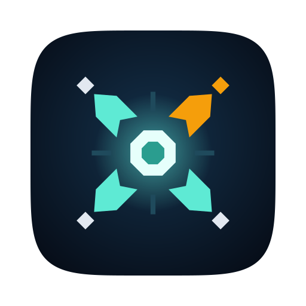

<p align="center">
  
</p>

# NEXUS

NEXUS is a macOS desktop app (Tauri 2 + React) that puts several AI coding agents behind one chat window. You connect the agents and accounts you already use (OpenAI Codex, Claude Code, Google Antigravity / Gemini API, Grok API, a local Qwen model through Ollama, Goose or your own ACP agent), organise work into projects, folders and chats, and NEXUS routes each request to a suitable model, shows the answer as it streams, and keeps the history locally.

The source lives in [`app/`](app). Working rules for contributors and coding agents are in [`AGENTS.md`](AGENTS.md) (in Russian); version history is in [`CHANGELOG.md`](CHANGELOG.md).

## What it does

**One chat for many agents**
- Streams answers progressively. One send button turns into **Stop** while generating; **Continue** finishes a stopped answer in the same message.
- Model and reasoning depth are chosen independently, both with an **Auto** option. A manual choice is passed to the agent as is and is never silently replaced; the actual model and mode are shown under every answer.
- Answer actions on hover and keyboard focus: reply with quote, copy, rate, time, model.
- Files can be attached, pasted or dropped. Previews never execute arbitrary HTML or code.
- Agent questions (single or multiple choice) and permission requests appear inline in the chat. Permissions need an explicit choice and are never granted as permanent full access; a refusal is returned to the agent.
- History is paged (40 latest messages, then older pages on scroll). Scrolling up stops auto-follow and shows a **Jump to latest** button.

**Projects, folders and chats**
- Left sidebar with projects, nested folders, chats and sub-chats. Sub-chats inherit the folder context and a bounded slice of the parent history.
- Project and folder settings accept several directories, local files, uploaded documents, links and notes as context, with a cap on total context size.
- Chats can be archived or moved to a recoverable trash together with their sub-chats.
- **Goals and tasks** panel next to the chat keeps project goals and the status of requests.

**Connections and accounts**
- One **Agents and connections** dialog with a catalog and an accounts tab. "Install and connect" queues the official installer and then the provider's official sign-in (ChatGPT for Codex, Google for Antigravity, Anthropic for Claude Code).
- Several isolated profiles per provider. Sign-in status is re-checked on launch, when the dialog opens, when the window regains focus and periodically.
- Quota bars show real data only: Codex `account/rateLimits/read`, Claude statusLine fields. Unknown limits are shown as unknown, never as made-up percentages.
- Grok and Gemini API keys are stored in the macOS Keychain and never written to JSON files, command lines, model context or diagnostics.
- Custom ACP agents can be added with a form or picked from the official ACP registry. Commands run without a shell; `initialize`, `authenticate` and `session/new` are verified.
- Local profile: `qwen3:4b` through Ollama, downloaded only on an explicit click with progress and cancel.

**Execution and verification**
- Chats start in **Discussion** mode. **Execution** mode lets Codex / Claude run their native tool loop with the normal approval flow (Codex stays in a read-only sandbox and asks for what it needs).
- Large requests get a short rule-based plan without an extra model call. AI planning is a separate action that clearly states it spends quota.
- **Team** mode splits a request into 2–4 stages, routes each stage to a compatible model and runs execution stages sequentially in the shared workspace.
- After execution NEXUS finds supported `npm` scripts (`lint`, `typecheck`, `check`, `test`, `test:visual`) and Cargo lib tests, shows the exact command, working directory and reason, and runs it only after a one-time approval (180 s limit). Codex and Claude get one attempt to fix failing checks. "Checks passed" is shown only after real successful checks.
- An optional independent review by the local Qwen model is a second opinion, not a substitute for tests.

**Look and feel**
- Calm dark theme with frosted-glass surfaces (`src/dialog-theme.css` holds the shared tokens for all dialogs and popups).
- The start screen shows a real-time WebGL particle portrait built from a 3D head scan (`Hi3D_Untitled_allparts_*.glb` → `public/persona/hi3d-head.points`) with light filaments; clicking the face sends a lightning discharge through the particles. While an answer is generated, a thinking-lightning effect connects the portrait to the message. Rendering pauses when the page is hidden and respects reduced motion; the chat works without WebGL.

## Repository layout

```
AGENTS.md                         Current working rules (Russian)
CHANGELOG.md                      Version history
docs/                             Model notes, agent rules history, old release notes
Hi3D_Untitled_allparts_*.glb      Source 3D scan for the particle portrait (kept locally, not in git)
generated_images/                 Concept images (kept locally, not in git)
.github/workflows/ci.yml          CI: UI tests, UI build, Rust tests on Linux
app/
  src/                            React UI (main.jsx = App, chat-message-view.jsx, dialogs, navigation, persona, styles)
  src-tauri/src/                  Rust backend: lib.rs (shared types, run, command registration) and modules
                                  for accounts, installer, adaptive routing, Claude usage, project store,
                                  chat send/stream/history, channels and the local API, permissions,
                                  verification, window state; Objective-C helpers for Keychain,
                                  Accessibility and background mode
  public/agents/                  Local brand icons for agents (sources in SOURCES.md)
  public/persona/                 Particle assets for the portrait (sources in SOURCES.md)
  scripts/                        Asset build scripts and macOS build/signing helpers
  tests/                          Node tests for UI logic (run-all.mjs) and an isolated UI preview
  UNIFIED_CHAT_V020.md            Detailed description of chat behaviour and checks (Russian)
  CHANNELS_V021.md                Task channels, local API and notifications (Russian)
```

User data (profiles, chats, projects, granted permissions) is stored in `~/Library/Application Support/NEXUS`.

## Requirements

- macOS (Apple Silicon or Intel)
- Node.js 22
- Rust toolchain (stable) and Xcode Command Line Tools
- The agent CLIs you want to use; NEXUS can install most of them for you

## Build and run

```bash
cd app
npm install

# UI logic tests and formatting
npm test
npm run format:check

# Rust tests (needs dist/ from `npm run build`)
npm run build
cargo test --manifest-path src-tauri/Cargo.toml --lib

# Development
npm run tauri:dev

# One-time: create a local code-signing certificate in the login keychain
npm run setup:signing

# Release bundle (signed with the local certificate, or ad hoc if it is missing)
npm run build:mac
codesign --verify --deep --strict src-tauri/target/release/bundle/macos/NEXUS.app
```

The result is `app/src-tauri/target/release/bundle/macos/NEXUS.app`. A stable local signature lets macOS remember "Always Allow" for NEXUS Keychain items across rebuilds; without it the bundle is signed ad hoc and Keychain prompts come back after each build. Neither is Developer ID signing or notarization.

### Isolated UI preview

The UI can be opened in a regular browser with in-memory fixtures and no real backend or accounts:

```bash
cd app
npx vite
# open http://127.0.0.1:1420/tests/ui-preview.html          (start screen)
# open http://127.0.0.1:1420/tests/ui-preview.html?history  (chat with sample messages)
```

## Limitations

- macOS only. Windows and Linux builds are not set up.
- A successful sign-in does not mean quota is available or that the agent can be used for chat routing; these are separate checks.
- API adapters (Grok, Gemini API, local Qwen) are text-only: no local files, images, terminal or tools, and no execution mode.
- Manual reasoning depth is not implemented for ACP / API agents; NEXUS asks to use **Auto** instead of ignoring the choice.
- The personal sign-in for the old Gemini CLI has been closed by Google; NEXUS offers Google Antigravity ACP or the Gemini API instead.
- There is no built-in browser automation, database or MCP server UI. A Playwright screenshot is only produced if the project itself has a `test:visual` script.
- Unit tests and the UI preview do not replace visual inspection of the packaged app or live runs with real accounts.

## Third-party assets

Agent logos and persona assets keep their original licences; see `app/public/agents/SOURCES.md` and `app/public/persona/SOURCES.md`.
