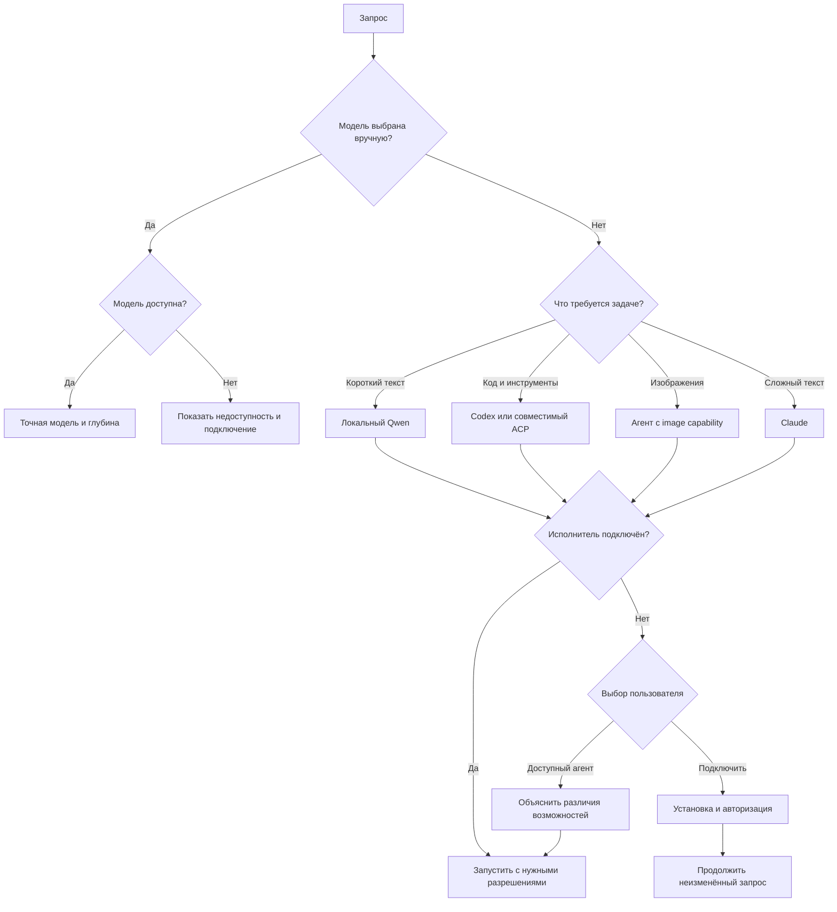

# Nexus: текущее устройство чата и подключений

Обновлено 11 ноября 2026. Рабочая папка — `app` (бывшая `v0.20.2`). Этот документ описывает код, а не подтверждает вход во все сервисы.

## Что было недоделано

- Gemini использовал официальный старый CLI, но личный Google-вход получал отказ провайдера. Авторизация и поддержка генерации были разными путями; Gemini не входил в нативный runner Codex/Claude.
- Grok `Connect API` открывал документацию, не создавал рабочее подключение.
- Goose был в списке без автоматического установщика.
- Пользовательские ACP-агенты уже имели начальный транспорт и карточку в системном чате, но обычной формы подключения не было. Идентичность записи зависела только от executable, проверка не доходила до создания сессии.
- В разделе Tools отдельно находились сканирование аккаунтов, AI planner, rule-based planner и старый runner. Основной чат работал как read-only turn.
- Цветная полоса технического сообщения наследовалась от старого `.chat-bubble.system`. Голограмма старого main была скрыта стилями.
- Число у папки означало число источников контекста, а не чатов. Полная история загружалась целиком в интерфейс; удаления и архива чатов не было.

## Интерфейс

Главная навигация: проекты → папки → чаты → подчаты. Внизу — архив, корзина, подключения, инструменты. Пустой чат показывает компактную CSS-голограмму и поле ввода; существующий — историю. Три альтернативных композиции подготовлены отдельно в `nexus-design-directions.html`; это предложения дизайна, не три переключаемые темы приложения.

Названия в дереве используют `FadeLabel`: полная доступная ширина, плавная маска при переполнении, перерасчёт через ResizeObserver при появлении действий. Клавиатурный фокус показывает действия; сенсорный ввод не зависит от hover. Счётчики включают вложенные папки и подчаты и исключают архив/корзину.

`CustomSelect` заменяет системные select во всех текущих компонентах. Popup использует единый стиль, поиск набором текста, Arrow/Home/End, Enter, Escape, disabled options и правильную привязку к модальному accessibility-дереву. Общие скроллбары тонкие, справа, без дорожки, угла и стрелок. Технические сообщения не получают широкую цветную карточку.

Чат сохраняет потоковый текст, Stop, продолжение в том же сообщении, форматирование, безопасные структурированные widgets/questions, вложения, цитаты и оценки. Выбор модели и рассуждений независимы. Ручной выбор не заменяется молча. Если ACP/API не умеет принимать ручную глубину, backend возвращает явную ошибку; нужен режим «Авто».

## История и жизненный цикл

`chat_message_page` возвращает 40 последних сообщений, затем предыдущие страницы по ID первого загруженного сообщения. Курсор принадлежит конкретному чату; максимум 60 записей на запрос. При prepend учитывается изменение scrollHeight; подгрузка не возвращает читателя в конец. Обновление хвоста сохраняет загруженные старые страницы и удаляет дубликаты/оптимистические pending-записи.

Это ограничение IPC и DOM. Файл `projects.json` backend пока десериализует целиком; виртуализация отдельных длинных сообщений и индексированная БД не реализованы.

Archive/trash — обратимые операции над веткой. Сообщения остаются в хранилище. Restore восстанавливает ветку и необходимых предков. Рабочую ветку перемещать нельзя. После действий дерево и счётчики обновляются событием; фоновая синхронизация остаётся дополнительной защитой. Постоянного удаления переписки нет.

## Подключения

`connections-dialog.jsx` объединяет каталог, аккаунты, форму своего агента, установку, вход и диагностику. Основное действие устанавливает CLI в очереди и продолжает подключение. OAuth остаётся у официального CLI, внешний терминал не открывается. Кнопки добавления нового аккаунта и удаления профиля доступны прямо в диалоге.

| Тип | Что реализовано | Ограничение |
|---|---|---|
| Codex | Официальный ChatGPT device login, App Server, модели, streaming, permissions | Доступ конкретной модели и квота зависят от аккаунта |
| Claude | Официальный login, изолированный профиль, stream control, aliases | Квоты из `rate_limit_event` в stream-json после ответа в чате; statusLine — дополнительно для терминальных сессий |
| Gemini CLI | Сохранены старые профили и официальный ACP auth | Старый личный вход отклонён Google; самостоятельного native generation adapter нет |
| Google Antigravity | Установщик официального ACP runtime, SHA-256, проверка подписи, authenticate/session | Новый вход и генерация требуют live-проверки; не заявлены успешными |
| Gemini API / Grok | Форма ключа, Keychain, список моделей, streaming, Stop, persistence | Текстовый API без терминала, локальных файлов и изображений. Grok: лимиты API-ключа (RPM/TPM из `x-ratelimit-*`, статус ключа из `/v1/api-key`); квоты подписки нет |
| Qwen локально | Установка/запуск Ollama, загрузка qwen3:4b, прогресс, отмена, API-подключение | Несколько ГБ, ресурсы Mac; реальные загрузка и inference требуют live-проверки |
| Qwen Code / Goose | Изолированные локальные настройки Ollama, ACP handshake/session, tools/permissions | Нужен установленный qwen3:4b; функции зависят от runtime |
| OpenCode / свой ACP | Проверка протокола и сессии, streaming, permissions | Провайдер должен быть настроен; не всякий CLI является ACP-агентом |
| Aider | Установка CLI через uv | Адаптера чата пока нет; интерфейс не обещает подключение |

Полный актуальный список ACP можно загрузить из официального реестра. Это не обещание автоматической установки любого формата. Для неподдерживаемой distribution нужно указать официальный executable/adapter; имя команды из npm package не угадывается.

API-ключи не хранятся в JSON, argv curl или контексте модели. Используется macOS Keychain через Objective-C bridge. Удаление API-записи удаляет ключ; удаление OAuth-профиля из Nexus сохраняет credentials официального CLI. Проверка моделей не доказывает возможность inference или наличие оплаченного баланса.

## Маршрутизация

Небольшой локальный router использует признаки задачи и доступность инструментов. Для простого текста предлагает локальный Qwen, для кода — Codex, для сложного текста — Claude, для изображений — подходящий ACP/Google либо доступного агента с файлами. Это объяснимая эвристика, не сравнительный benchmark моделей.

Если предпочтительный агент не подключён, пользователь выбирает подключение или доступного исполнителя. Черновик остаётся на месте. После успешного подключения тот же запрос продолжается только если не изменились чат и текст. Эта пауза хранится в текущем интерфейсном сеансе; её восстановление после перезапуска ещё не реализовано.

Дерево выбора, включая ещё не подключённых исполнителей:

Модели приходят из живого CLI/API discovery. Для ACP доступен provider-default. Автовыбор не выдумывает версии моделей. Квота и логин независимы: Codex сообщает официальные окна, Claude может прислать statusLine; неизвестная квота не означает отсутствие входа.

Лимиты в списке аккаунтов отображаются постоянно двумя независимыми progress-полосами: использование, остаток и дата восстановления. Длительности окон Codex берутся из `windowDurationMins`; Claude — из реальных fiveHour/sevenDay. Отсутствующие значения не рисуются как 0%. Во время обновления сохраняются последние подтверждённые полосы, устаревшие данные помечаются. В раскрытии остаются источник и диагностика; для Claude доступна явная настройка statusLine-источника. API без quota endpoint показывает «Нет данных».

## Цели, планирование и выполнение

Цели и задачи хранятся в `projects.json` с serde defaults. Активные цели включаются в ограниченный контекст. Запрос получает статус: в работе, проверка, ждёт проверки, ответ получен, проверки пройдены, ошибка, остановлена или прервана перезапуском. Незавершённые команды не перезапускаются сами после сбоя.

Большой запрос (>1200 символов или четыре пункта) получает короткую плановую инструкцию без дополнительного вызова модели. Подробный AI planner доступен отдельно; его результат переносится в черновик. Это один исполняющий агент на запрос, не DAG параллельных автономных агентов.

- «Обсуждение»: изучение и ответ, без правки проекта.
- «Выполнение»: нативный execution loop и разрешения агента. Codex по умолчанию остаётся read-only и запрашивает расширение. У стороннего ACP OS sandbox зависит от runtime.
- После выполнения обнаруживаются npm lint/typecheck/check/test/test:visual и Cargo lib tests. Каждая команда получает отдельное подтверждение с cwd и причиной.
- Проверка ограничена 180 секундами. Остановка завершает её группу процессов.
- Для Codex/Claude ошибка возвращается тому же аккаунту на одну попытку исправления; затем проверки повторяются с новыми подтверждениями. Уже показанный префикс ответа остаётся доступен при исправлении и Stop. Для ACP host-repair пока нет.
- Успех реальных проверок даёт статус «Проверки пройдены». Отказ, отсутствие команд или сбой оставляют задачу на проверке. Это не автоматическое подтверждение всех критериев пользователя.
- При подключённом локальном Qwen отдельный ограниченный запрос просматривает нативный результат и сводку проверок. Он не получает инструменты/файлы и не считается доказательством тестирования. Для ACP этот дополнительный host-review пока не подключён.

Постоянный браузер, database tools, интерфейс настройки MCP, полноценный visual runner и автоматическое создание скриншотов не добавлены. `test:visual` выполняется только если он настроен в проекте. Нативный агент может иметь собственные дополнительные инструменты, но наличие их не гарантируется Nexus.

## Проверки и ограничения проверки

Автоматически: `npm test` (отправка, Stop, продолжение, модели, вложения, вопросы, plural forms, прокрутка, счётчики, пагинация, router и отображение квот), `cargo test --offline --manifest-path src-tauri/Cargo.toml --lib` (в том числе миграция/курсоры/жизненный цикл/разрешения/проверки/безопасные API-параметры). Сборка: `npm run tauri:build -- --bundles app -- --offline`.

Нативный осмотр новой сборки: проверены новое окно подключений, реальные существующие статусы Codex/Claude, кастомный popup фильтра и обновлённые счётчики/навигация. Найден и исправлен конфликт старого CSS, скрывавший селекторы composer. Архив/корзина и пагинация покрыты автоматическими тестами; пользовательские чаты ради проверки не удалялись и не перезаписывались.

Запуск Vite-сервера в среде агента блокируется sandbox (`listen EPERM`), поэтому Playwright браузерная проверка не заявляется выполненной. Изолированная fixture-страница находится в `tests/ui-preview.html` и может запускаться в обычном dev-окружении. Новая OAuth-авторизация Antigravity, реальный API-ключ Grok/Gemini и загрузка/inference Qwen в этом проходе не проверены. Успешная сборка и handshake-код не заменяют эти проверки.

## Источники для интеграций

- Google: https://developers.googleblog.com/an-important-update-transitioning-gemini-cli-to-antigravity-cli/
- Официальный ACP Google: https://antigravity.google/docs/ide/extensions/acp/
- Реестр: https://cdn.agentclientprotocol.com/registry/v1/latest/registry.json
- Goose: https://github.com/aaif-goose/goose и https://github.com/aaif-goose/goose/blob/main/documentation/docs/gdk/acp/index.md
- Qwen config: https://qwenlm.github.io/qwen-code-docs/en/users/configuration/model-providers/
- Ollama install: https://github.com/ollama/ollama/blob/main/scripts/install.sh
- Исходная статья о harness: https://habr.com/ru/articles/1023316/

## Унификация окон

Общий `src/dialog-theme.css` задаёт нейтральный графитовый стиль настроек проекта/папки/чата, инструментов, подключений, архива, корзины и предпросмотра: радиус 18 px, поля и кнопки 9 px, основной отступ 24 px (18 px на узком окне), заголовок 18 px, одинаковое закрытие и вкладки. Инструменты имеют отдельную прокручиваемую область содержимого; прежнее прижатие текста к краям устранено. Меню дерева и CustomSelect используют общие токены всплывающих поверхностей. Проверка: npm test и production-сборка; новый визуальный осмотр этой правки в живом приложении не проводился.

## Трёхмерный персонаж: фактическое состояние

Стартовый экран получил композицию «Тихий контакт» и `ParticlePersona`: процедурная голова с чертами лица, волосы, шея, плечи и основание из примерно 56 тысяч точек в трёхмерном пространстве. WebGL выполняет перспективную проекцию, поворот за курсором и мягкое движение. RAF ограничен примерно 30 кадрами/с, pixel ratio ограничен 1.6; reduced-motion выключает постоянную анимацию, скрытие окна/сцены приостанавливает рендер. При размонтировании буферы и шейдеры освобождаются. Растровый концепт не используется вместо 3D.

Правая карточка содержит первые два существующих аккаунта и настоящие данные квоты, открывает полное окно подключений. На узких/низких окнах карточка скрывается, подключения остаются доступны в навигации. Цели и задачи используют прежний ProjectBoard, выдуманного процента цели нет. В переписке персонаж размонтируется.

Проверки: npm test, macOS production build успешны. В нативной сборке осмотрен новый пустой чат, WebGL-персонаж виден, карточка показывает подтверждённые аккаунты и реальную квоту Codex. Для осмотра создан один пустой чат. Художественное ограничение: процедурное лицо схематичное, сходство 1:1 с изображением НЕ достигнуто; требуется детальная 3D-модель и распределение частиц по её поверхности.

## Уточнение: персонаж по изображению и ввод

Процедурное схематичное лицо заменено 118 975 точками из утверждённого чистого изображения персонажа. Офлайн `scripts/persona-rgb.swift` переводит PNG в PPM, `scripts/sample-persona.py` сохраняет XYZ/RGB/seed в `public/persona/quiet-contact.points` (3 331 300 байт). На старте загружается только массив точек; ни изображение, ни текстура не отображаются. Фронтальная ортографическая проекция сохраняет положение и цвет исходных образцов, фон отсекается порогом яркости. Рельеф глубины приближённый: небольшие повороты/параллакс допустимы, достоверного вида сзади нет. Цвет сохраняется, движение лица слабее движения периферии.

Подсказка поля ввода теперь доступна только при value.length === 0 и исчезает при первом символе, включая пробел и вставку. Общие CSS-переменные синхронизируют её размер, строку и отступы с textarea на всех размерах окна.

## Отдельное окружение и анимация персонажа

Последняя версия отделяет гладкий фон с лучами (`environment.png`) от облака. Из семплирования исключены луч и отражение пола; на каждую точку приходится собственная случайная позиция внутри ячейки (раньше общий Y создавал ряды). Размеры неодинаковы. Всего 95 595 точек, включая 3 200 отдельных искр пола; формат XYZ/RGB/seed/size/layer, 9 float. Искры дрейфуют и мерцают независимо от поворота лица. Дым — три плавно движущихся полупрозрачных слоя, reduced-motion отключает движение. Это визуальная анимация тумана, не физическая симуляция жидкости.

Персонаж вращается мышью с pointer capture, доступен ползунок ±48° и сброс. Автоматическое моргание раз в 5.7 с, ручное «Моргнуть», пробная улыбка деформируют соответствующие части облака. Глубина остаётся рельефом из одного вида; круговая анатомическая модель, rig, речь и lip-sync не реализованы.

## MakeHuman/MPFB: замена рельефа полноценной моделью

Использован предоставленный архив MPFB 2.0.18. Монтирование Blender DMG завершилось Device not configured; приложение Blender не установлено. Сетка и targets доступны прямо в ZIP, поэтому сборщик читает только данные без исполнения addon. Из MakeHuman hm08 получена женская голова/шея/плечи (4595 вершин, 9134 треугольника). Дополнительно смягчены челюсть, подбородок и нос, изменён объём губ. Геометрия сохранена в makehuman-head.obj. 110 тысяч точек распределены по площади треугольников, дельты век и улыбки интерполированы теми же барицентрическими весами. Доступен полный круговой поворот.

Добавлены 680 собственных объёмных прядей (64600 точек), плавно движущихся у концов. Волосы не взяты из пакета готовых причёсок. Отдельно сохранены 3200 частиц пола, дым и гладкий фон. Новый формат 18 float/точку, 177800 точек. Полный набор выражений и lip-sync отсутствуют: архив expressions пуст, используются штатные modeling targets.

Камера считает границы фактических точек и запас для наклона/поворота; сцена без отрицательных layout-отступов и без crop фона. tests/persona-asset.mjs проверяет лицевые дельты, наличие волос/пола/глубины и вписывание для аспектов 0.25–4, полного yaw и ±0.3 pitch.

### Завершение проверок после восстановления среды

`npm test` прошёл полностью, включая `persona-asset.mjs`: глубина модели, дельты век/улыбки, волосы, отдельный пол и вписывание при разных пропорциях окна и поворотах. Последовательная macOS-сборка `npm run tauri:build -- --bundles app -- --offline` успешно завершена; NEXUS.app включает волосы, мягкие пропорции лица и автоматическое кадрирование. Визуальный осмотр именно финальных волос и кадрирования после восстановления среды не выполнен: инструмент управления интерфейсом недоступен. Ранее осмотрена базовая MakeHuman-геометрия и круговой поворот.

## Hi3D: текущий персонаж (заменяет MakeHuman в runtime)

- Пользовательский `Hi3D_Untitled_allparts_20261111_184233.glb` содержит четыре раздельные головы андроида. `scripts/build-hi3d-persona.mjs` выбирает крупнейшую связную поверхность (288 807 вершин, 577 786 треугольников), нормализует и семплирует её по площади. Не загружать все головы в сцену. Исходный GLB остаётся неизменным.
- Runtime загружает `public/persona/hi3d-head.points`: 420 000 точек поверхности и 3 200 точек пола, прежний stride 18 float. Нормали сглажены, морф-дельты нулевые. Метаданные и SHA-256 исходника: `hi3d-head.json`. Старые MakeHuman и image-relief ассеты не используются.
- В исходнике нет волос, текстур, rig, morph targets или animation clips. Не обещать моргание/улыбку: кнопки убраны до отдельной настройки лицевой анимации. Есть круговое вращение, лёгкое движение частиц, анимированные дым и пол. Лицевую анимацию пользователь по-прежнему хочет; это незавершённая часть задачи.
- Поверхность рисуется частицами в два прохода с depth prepass для устранения просвечивания. Фон остаётся contain; маска вычисляется на блоке с пропорциями самого изображения 1585/992, чтобы сгладить прямоугольные края.
- `npm test` проверяет структуру, нормали, выделение одной головы и вписывание при разных пропорциях окна/поворотах. Эти проверки не заменяют визуальный осмотр WebGL в приложении.

### Контраст частиц Hi3D
- Текущий ассет: 64 000 точек головы и 1 200 пола (вместо 420 000/3 200). Сэмплирование усилено на изменениях нормали в окрестности .025 единицы, чтобы выделять стыки, а не рёбра каждого треугольника.
- Stride 18 float сохранён, но поля 9/10 теперь curvature/accent, а не blinkDelta. Это данные оформления, не facial morphs. Разная величина точек, приглушённая поверхность, яркие холодные и редкие тёплые акценты.
- Depth prepass использует расширенные точки и небольшой сдвиг глубины. Цветовой проход рисует мягкое ядро и ореол; отдельные коэффициенты alpha-blending сохраняют корректную прозрачность canvas.
- Фон: плавное движение гладких лучей, изменение света и дым. CSS-анимации ставятся на паузу при скрытой сцене/странице, reduced-motion отключает их. Поворот персонажа не поворачивает фон.

- WebGL: `depthPass` явно `lowp` в обеих стадиях; общие varyings явно `mediump`. Различие precision общего uniform ломает link в WebGL 1. Регрессия проверяется в tests/persona-asset.mjs. Ошибки загрузки/компиляции/link показывать с причиной под раскрытием, не объявлять их отсутствием поддержки WebGL.

- Пол под Hi3D: компактный диск радиусом .52 с фиксированным визуальным наклоном (`y = -.82 + z*.42 + jitter`) и радиальным затуханием. Не возвращать почти постоянный Y: ортографическая камера превращает горизонтальную XZ-плоскость в полосу. Пол не вращается вместе с головой.

### Световые нити по референсу
- `scripts/build-persona-filaments.mjs` запускать после генерации `hi3d-head.points`. Он строит 72 коротких плавных пути по соседним точкам поверхности с проверкой нормалей и разрывов. `hi3d-filaments.bin` — треугольные ленты, stride 18; метаданные рядом.
- Нити имеют узкое ядро и мягкий ореол с затухающими краями/концами. Преобладают бело-голубые оттенки, каждый 13-й путь янтарный. Это отдельный геометрический проход, не каркас всех треугольников головы. Вращение и проверка глубины общие с персонажем.
- `linePass` и `depthPass` имеют одинаковый lowp в обеих стадиях шейдера; в проходе нитей не использовать gl_PointCoord. Тест проверяет интерфейсы стадий и корректность ассета нитей.

### Фиксированный ракурс и молния по клику
- Вращение, реакция ракурса на курсор, ползунок и кнопка сброса удалены по просьбе пользователя. Портрет неподвижен; частицы, фон и нити сохраняют анимацию.
- Клик/тап по проекции лицевой поверхности запускает разветвлённую SVG-молнию наружу, привязанную к ближайшей видимой точке модели. Клик по пустому фону ничего не делает. Enter/Space на canvas доступен с клавиатуры. Ограничение частоты 450 мс, эффект 700 мс, таймеры очищаются при закрытии. Reduced-motion — спокойное затухание. Это экранный эффект, не физическая симуляция разряда.
- Световых путей 144 вместо 72. Размер частиц увеличен примерно на 28%, базовая яркость и непрозрачность подняты для читаемости поверхности. Количество точек прежнее.
- Для фона убран отдельный нижний радиальный ореол и добавлен слабый статический dithering для сглаживания полос градиента.

- Молния обновлена: нерегулярный канал через рекурсивное смещение середины, сужающийся ствол, случайные короткие ветви и вторичные ответвления. Канал раскрывается от поверхности наружу за десятки миллисекунд, затем быстро гаснет; без повторяющегося строба. Ядро белое, ореол тонкий голубой, локальная вспышка только у источника. Проверки контролируют соединённость участков, толщину и задержки. Это художественный SVG-эффект, не физическая 3D-симуляция.

### Разряд и возбуждение частиц — 8 секунд
- `internalDischarge` строит внутренний путь из 12 точек от клика к краю видимого силуэта. Внешняя молния начинается точно на конце внутреннего пути с задержкой 605 мс.
- Шейдер получает `chargePath[12]` и `chargeAge`, подсвечивает и увеличивает частицы в окрестности пути после прохождения импульса; лёгкое смещение отключено при reduced-motion. Пол не возбуждается. Это воздействие на проекцию видимой поверхности, не объёмная электрофизическая симуляция.
- Возбуждение и SVG-послесвечение затухают за 8 секунд; затем эффект удаляется. Новый клик перезапускает один разряд, без накопления бесконечных эффектов. Таймеры очищаются при unmount; при reduced-motion WebGL обновляется только на время плавного затухания и затем снова останавливается.
- Тесты эффекта проверяют соединение внутреннего и внешнего путей, задержку выхода, конечность данных и нулевое возбуждение после 8 секунд.

## Дерево моделей и выбор для чата — 11.11.2026

`CustomSelect` поддерживает специализированное дерево (`model-tree-select.jsx`) с поиском по агенту, ID и назначению. Доступны общий «Авто», `agent-auto:<provider>` и конкретная модель. Выбор хранится в `NexusChat.model_choice` через `save_chat_model`, с serde default. Ошибка сохранения оставляет прежний выбор; ответ записи обновляет только исходный чат. При неизвестной или несовместимой ручной модели отправка останавливается.

`agent-catalog.js` фильтрует по режиму выполнения, наличию файлов/изображений, ручной глубине и готовности подключения. Обсуждение кода само по себе не требует инструментов. Первая строка списка больше не определяет модель. Резервный выбор использует isDefault, затем runtime default, затем стабильный ID; опубликованные сравнения имеют приоритет при достаточном покрытии (см. ниже). Общий Auto выбирает совместимый fallback без предложения обязательной установки конкретного бренда. API отклоняет любые вложения также на backend. Специализированные медиа/embedding/audio/multi-agent/approval модели показаны, но не отправляются в обычный чат. Codex model/list обходит страницы каталога с ограничением и проверкой курсоров.

У ACP при подключении сохраняется объявленная поддержка изображений; старое неизвестное значение не выдаётся за поддержку. Индивидуальные модели ACP пока не обнаруживаются и не переключаются — доступен runtime-default. У API/Gemini и собственного сервера доступны все ID их ответа models. Качество API-подключения не приравнивается к возможностям внешней модели использовать инструменты.

`model-profiles.js` содержит справочные сведения точных версий, источники и дату, отдельные тарифы медиа, пример цены одинакового текстового объёма и неизвестные значения. Полный разбор — `MODEL_SELECTION.md`. Числовые рейтинги качества не выдумываются, подписка не пересчитывается по API-тарифу. Каталог 15 подключений включён целиком; неизвестные модели показываются без фиктивной цены.

Проверено: тесты JS и Rust; в отдельном браузерном стенде — поиск, просмотр характеристик, применение модели, Auto внутри агента, стрелки клавиатуры, недоступные медиа-модели и Escape с возвратом фокуса. Визуально исправлено влияние старого глобального стиля aside. Реальные запросы через аккаунты и измерение качества моделей не выполнялись.

Итог сборки этой правки: `npm test` прошёл (включая model-selection), Rust — 27/27, `npm run tauri:build -- --bundles app -- --offline` завершён успешно. Артефакт: `src-tauri/target/release/bundle/macos/NEXUS.app`. Сборщик оставляет предупреждения о размере JS и существующем Objective-C коде доступности macOS; они не остановили сборку.

## Автовыбор по публичным сравнениям — 11.11.2026

`model-benchmarks.js` хранит проверенный снимок AA v5.0.1 и Arena Text/WebDev/Vision с точными ID, датами, режимами, интервалами и ссылками. Полный разбор каждой записи каталога и ограничения — `MODEL_BENCHMARKS.md`. Это внешние данные; собственных вызовов моделей не было.

После фильтра возможностей `routingAdvice` сравнивает минимум две точные версии в одном наборе. Для веб-разработки используется Arena WebDev, для текста — Arena Text, изображений — Arena Vision; общий код и сложные рассуждения используют смешанный AA Index как косвенный ориентир. В AA варианты в пределах 3 баллов лучшего выбираются по расходу теста (только полностью API-набор), затем времени. Это продуктовый компромисс, не статистическая граница. Для Arena API-кандидаты с пересекающимися интервалами сравниваются по цене фиксированного объёма токенов, не по выдуманной стоимости успешного запроса.

Авто использует внешний результат как предварительный ориентир, не меняя глубину; отличие режима явно указано. Ручная глубина требует совпадения low/medium/high. Алиасы, несовпадающие версии, Default Fallback и данные старше 90 дней исключаются. При недостатке покрытия явно показывается резервный выбор; незамеренные модели не получают нулевой рейтинг. В карточке модели опубликованные сравнения раскрываются отдельно. Под композером объяснение выбора по тестам свёрнуто по умолчанию. Ссылки открываются только на разрешённых HTTPS-доменах AA и Arena.

Проверки: `npm test`, включая новые проверки сравнения категорий, цены, качества, даты, режима, алиасов и ручного выбора; Rust 27/27. Обновлённый интерфейс в этом изменении отдельно визуально не проверялся; отправка через подключённый аккаунт не выполнялась.

Сборка после интеграции публичных сравнений и сворачивания объяснения: успешна, `NEXUS.app` (23.82 MiB). В снимке 39 записей измерений для 15 моделей; для остальных из 32 профилей указаны ограничения и источники без выдуманных оценок.

## Приоритет автовыбора и сравнение альтернатив

Чат сохраняет `routing_priority` (serde default: None → balanced), независимо от модели и глубины. Команда `save_chat_routing_priority` принимает только balanced/quality/economy/speed, проверяет активность чата и отсутствие генерации, пишет под PROJECTS_LOCK. Ошибка записи сохраняет прежний выбор; при смене чата ответ записи применяется только к исходному чату. CustomSelect приоритета отключён для ручной модели. Изменение приоритета отменяет продолжение старого ожидающего запроса.

Balanced: группа в пределах 3 баллов AA либо пересекающихся с лидером интервалов Arena. Quality: только лучший балл AA, для Arena та же неопределённость интервалов. В группе используются сопоставимые стоимость, затем время, иначе стабильный ID без заявления превосходства. Economy и Speed рассматривают всех кандидатов с оценкой, допускают снижение качества, но применяются только при полном покрытии выбранной метрики; иначе явно возвращаются к группе качества. API-стоимость не применяется к подпискам. Время других тестов не переносится на текст/изображения.

Классификация отдельно подписывает исправление кода, разработку, веб-разработку, рассуждения, редактуру, перевод, тексты и анализ изображений. Это локальные эвристики, не модельный вызов. Перевод/редактура пока используют Text Overall с оговоркой; общий код/рассуждения — смешанный AA. UI `routing-preview.jsx` показывает выбранную модель и до двух совместимых альтернатив, оценку/режим/дату, сопоставимое время/цену или неизвестность, покрытие и причину выбора. Подробности свёрнуты по умолчанию, внутреннего скролла нет. При недостатке данных альтернативы показываются без фиктивного рейтинга.

Это заменяет прежнее правило выбора максимального балла Arena при пересечении интервалов. Новых внешних замеров или запросов к аккаунтам не выполнялось.

Проверка приоритетов: полный `npm test` прошёл, Rust 27/27. Добавлены сценарии снижения качества в Economy/Speed, отсутствия цены подписки, неопределённости Arena, выбора альтернатив, классификации русских запросов, смены чата во время сохранения и ошибки записи. Отдельный визуальный осмотр нового блока и реальные запросы через аккаунты не выполнялись.

- Слои стартового экрана: `.nexus-welcome > .particle-persona` имеет собственный stacking context (`z-index:0; isolation:isolate`); карточка подключений и кнопка её возврата — `z-index:1`. Внутренние canvas/молнии не должны перекрывать клики по каталогу, подключению агента и закрытию карточки.

### Общий фон и стеклянный UI
- `ParticlePersona` монтируется один раз в `.workspace-persona` на уровне App, вне истории чата. WelcomeScreen содержит только карточку подключений. При появлении сообщений персонаж не размонтируется и не прокручивается вместе с историей.
- В открытом чате фон не перехватывает мышь/клавиатуру (`interactive=false`, tabIndex=-1, pointer-events:none). На стартовом экране пустые участки пропускают клики к персонажу; кнопки, композер и карточки остаются интерактивными над ним.
- Полупрозрачные поверхности используют backdrop blur 28–32px: история, навигация, шапка, композер, подключения, панели задач; общие окна и popup оформлены через dialog-theme.css. Размывается фон, а не текст или кнопки. Ответы агента сохраняются без индивидуальных карточек.
- Пагинация, refs прокрутки и следование за потоком не меняются. Canvas единственный; reduced-motion, остановка при скрытии и освобождение ресурсов сохранены.

## Ручная проверка в приложении и обработка отказа провайдера

11.11.2026 в собранном Nexus создан отдельный проект «Проверка маршрутизации 11 ноября» (/private/tmp), без источников контекста. Для одинакового короткого запроса о Python: Баланс показал gpt-6.1-sol, Качество gpt-6-astra, Скорость gpt-6-sol. Два реальных Codex-вызова завершились ответом 5, в метаданных Nexus сохранены gpt-6-sol и gpt-6-astra. Эти ID передаются app-server в thread/start и turn/start; подпись Nexus отражает запрошенную модель, отдельного подтверждения внутренней версии провайдера не получено. После полного выхода и запуска оба чата восстановили разные приоритеты и ответы.

Claude Personal: вход подтверждён, реальный запрос завершился ошибкой, которую старый обработчик назвал subscription limit. Исходная ошибка была отброшена при исчерпании маршрута, поэтому точную причину этого вызова подтвердить нельзя. Это не успешная проверка генерации Claude. Данные пользователя/история/блокировки не удалялись.

Исправление: `chat-errors.js` переводит ошибки отправки в понятные сообщения без raw JSON, имён аккаунтов и маршрутов; есть кнопки подключений и закрытия, черновик сохраняется. При смене чата старая ошибка сбрасывается. Backend возвращает NEXUS_RATE_LIMIT (ограничение запросов, не утверждение о подписке) либо NEXUS_ACCOUNT_UNAVAILABLE. Распознавание квоты проверяет конкретные поля ошибок; общие упоминания weekly/usage limit и успешные ответы не блокируют аккаунт. JS и 28 Rust-тестов проходят.

После перезапуска исправленной сборки отказ недоступного Claude показан по-русски с кнопками подключений/закрытия, контрольный запрос остался в поле ввода. Повторной генерации Claude не произошло: текущая блокировка исключила его до отправки. Дополнительно убраны дублирование ошибки и технический agent-auto ID из подписи недоступного агента.

- Коррекция стеклянного чата по скриншоту: не накладывать backdrop blur и рамку на всю `.chat-scroll-area` — это скрывает персонажа и создаёт огромную мутную карточку. История прозрачна, фон в переписке приглушён до .58 без размытия; сильный blur остаётся на реальных поверхностях управления и пользовательском пузыре. Заголовок/цели выровнены по колонке 800px с композером; отдельной карточки заголовка нет. Ответы агента не обрамлять.

## Компактное уведомление над полем ввода

По выбранному пользователем оформлению ошибка отправки вынесена из композера в `ChatNotice`: нейтральная поверхность, небольшая info-иконка, краткий заголовок, Подключения, крестик; подробности свёрнуты. Нет красной строки во всю ширину и тяжёлых кнопок внутри ввода. Текст ошибки маршрутизации показывается после попытки отправки в уведомлении, а не возвращается в поле ввода после закрытия. В нативном Nexus визуально проверены положение над вводом, раскрытие подробностей и закрытие; текст черновика сохраняется. Это изменение оформления, не подтверждение исчерпания квоты Claude.

- По новой просьбе пользователя сообщения пользователя И агента имеют локальные стеклянные подложки (blur 36px, полупрозрачный фон). Это заменяет старое правило о полностью необрамлённом ответе. Не размывать текст и всю историю целиком. Технические детали — компактная подложка по содержимому.
- Сглаживание фона: основа App теперь однотонная, без второго радиального градиента. Нельзя приглушать opacity всей `.workspace-persona`: это повторно квантует тёмные переходы; приглушается только canvas. Статичный монохромный шум soft-light остаётся поверх окружения и под персонажем/интерфейсом для уменьшения banding.

- Стекло в духе iOS: единые `--glass-*` токены в dialog-theme.css задают полупрозрачный корпус, blur 30px/saturate 145%, верхний светлый кант и внутренние отражения. Применять к сообщениям, композеру, подключениям, панелям и popup; текст не размывать. Это CSS-стилизация, не нативный Apple Liquid Glass и не физическое преломление. Есть непрозрачный fallback и prefers-contrast. Не возвращать общую стеклянную карточку на всю историю.

- Во время генерации `ThinkingLightning` рисует анимированный разряд от проекции точки на голове к видимой части текущего ответа (до первого текста — к индикатору ожидания). Поддерживается продолжение существующего ответа. Световой импульс идёт от головы к сообщению; координаты обновляются при скролле и изменении размеров. При скрытом сообщении/вкладке разряд скрыт, по завершении/Stop/смене чата удаляется вместе с наблюдателями и RAF. SVG не перехватывает ввод. При reduced-motion линия статичная без бегущего импульса. Это локальный визуальный индикатор генерации, не отображение внутренних рассуждений модели.

- Локальная macOS-сборка требует `bundle.macOS.signingIdentity: "-"` (ad-hoc подпись всего bundle). После сборки проверять `codesign --verify --deep --strict` для NEXUS.app; linker-signed executable без подписи bundle недостаточен. Это локальная подпись, не Developer ID/notarization. Проверка подписи не доказывает успешный запуск окна.

## Команда исполнителей — 12 ноября 2026

В композере добавлен сохраняемый для каждого чата выбор «Один агент / Команда» (`teamEnabled`, serde default false). В режиме команды локальный планировщик выделяет 2–4 явно перечисленных пункта; порядок пунктов задаёт консервативную цепочку зависимостей. Для запроса с интерфейсом и сервером создаются два независимых предложения по интерфейсу и контракту данных. Другие запросы остаются у одного агента: универсального AI-разбиения пока нет. План, назначения и причины доступны под раскрытием до отправки. Каждый специалист и итоговый агент расходуют отдельный вызов.

Для каждой подзадачи применяется существующий routingAdvice с приоритетом чата, фильтрами возможностей и внешними benchmark-данными. Это не новые собственные измерения качества. Ручная модель и «Авто внутри агента» ограничивают всю команду; назначение разных провайдеров не является обязательным. Backend повторно проверяет границы ручного выбора, число этапов, модели и зависимости (без циклов/ссылок вперёд).

`orchestration.rs` запускает до двух готовых подзадач параллельно. Специалисты дают предложения, код и критерии проверки; единственным исполнителем изменений остаётся итоговый агент в обычном цикле чата с подтверждениями и проверками. Codex использует read-only sandbox, дополнительные разрешения отклоняются. Claude получает только Read/Glob/Grep, запросы разрешений отклоняются. Это ограничения runtime, не новая универсальная OS-песочница. ACP пока может объединять результаты, но исключён из специалистов из-за отсутствия единого гарантированного read-only режима. API-специалисты работают только с текстом.

Результаты, состояния, длительности и назначенные модели подзадач сохраняются в `Task.team` в projects.json и видны в задачах проекта. Результат ограничен 12 000 символов с явной пометкой сокращения; итоговому агенту передаются до 6 000 символов на этап. Отдельные потоки не перемешиваются с итоговым ответом. Stop отменяет активные дочерние запросы и ждёт очистки процессов; завершённые предложения остаются в задачах. При ошибке зависимые этапы блокируются, итоговая генерация не начинается. После перезапуска незавершённые этапы показаны прерванными и автоматически не повторяются. «Продолжить» продолжает обычный ответ, но не перезапускает граф команды.

Проверки: frontend-тесты планирования и передачи плана; Rust-тесты графа, ограничения параллелизма, остановки двух дочерних запросов с ожиданием очистки, Unicode-сокращения и обратной совместимости сохранения. Визуальный осмотр и реальный запрос новой команды требуют отдельной проверки: при первой попытке Mac был заблокирован.

Итог автоматической проверки этой реализации: `npm test` — успешно; `cargo test --offline --manifest-path src-tauri/Cargo.toml --lib` — 32 теста успешно; macOS bundle собран офлайн. Тест одновременной отмены выявил и устранил пробуждение только одного исполнителя: Control теперь уведомляет всех подписчиков Stop. Визуальная и аккаунтная проверка нового режима остаётся непроведённой из-за заблокированного экрана Mac.

### Реальная проверка команды в macOS — 12 ноября 2026, 08:40–08:44

Предыдущая блокировка экрана снята. Через нативный интерфейс собранного NEXUS.app создан отдельный чат «Проверка команды Nexus…» в существующем проверочном проекте без исходников. Выполнен реальный запрос через подключённый Codex: подзадача Python `2 + 3` назначена `codex/gpt-6.1-sol`, завершена за 6.5 с с ответом `5`; перевод «кошка» назначен `codex/gpt-5.6-sol`, завершён за 5.3 с с ответом `cat`. Итоговый ответ содержит оба правильных результата, метаданные итогового исполнителя — `gpt-6.1-sol`, low. Эти длительности относятся к отдельным вызовам и не являются сравнительным бенчмарком. Назначенные ID видны в плане/сохранённых этапах; независимое подтверждение внутренней версии модели от провайдера для каждого этапа не добавлено.

Проверен второй реальный запрос «интерфейс React + сервер API» в обсуждении. При приоритете «Скорость» интерфейс назначен GPT-6-Astra с явной оговоркой о недостатке данных времени; сервер — GPT-6-Sol. Оба независимых этапа запущены и остановлены кнопкой Stop: в задачах оба имеют статус «Остановлена», длительность 11.8 с. Итоговый вызов не запускался; в истории сохранена остановка. Наличие двух остановленных состояний подтверждено интерфейсом, отдельный аудит OS-процессов не проводился.

Nexus закрыт через Cmd+Q и запущен вновь. В проверочном чате восстановлены «Команда», «Скорость», правильный итоговый ответ и результаты завершённых этапов. В соседнем чате B по-прежнему «Один агент» и «Качество»; возврат в проверочный чат восстанавливает его собственные настройки. Интерфейс осмотрен на скриншоте. Межпровайдерная команда (Claude/ACP/API), изменения файлов и сложные прикладные результаты этим прогоном не проверялись. Исходники приложения в ходе проверки не менялись; повторная сборка не требовалась.

- Мелкие поверхности каталога и навигации используют общие --surface-quiet/hover/selected: поиск полупрозрачный, теги контурные без серой заливки, логотипы без плиток. Выделять строку чата целиком, не рисовать отдельную серую подложку кнопки названия при hover.

### Исключение диагностического ACP из автовыбора — 12 ноября 2026

Подключение «Проверка ACP» (`/tmp/nexus-acp-fixture`) отключено штатной кнопкой интерфейса. История и профиль сохранены. Это была диагностическая заглушка с фиксированным ответом, не модель.

Автоматический routingAdvice исключает все пользовательские ACP (`custom-*`): у них подтверждена только совместимость протокола, а не реальная генерация. Ручной выбор конкретного ACP остаётся доступен. «Авто внутри агента» для пользовательского ACP скрыт и отклоняется backend, включая ранее сохранённые значения. У нативных и API-моделей автовыбор сохранён. Это консервативное ограничение, а не автоматическое распознавание любых тестовых программ. Запросы об устройстве текущего проекта требуют инструментального адаптера; текстовый API не предлагается как замена чтению локальных файлов.

Регрессии проверяют исключение единственного/default ACP, выбор нативного кандидата вместо него, запрет ACP Auto, сохранение ручного выбора и требование доступа к проекту. npm test и 32 Rust-теста прошли.

После сборки и перезапуска проверен фактический повторный запрос пользователя «Объясни, как устроен этот проект» в AIVERSE: получен полный содержательный ответ, в метаданных `gpt-5.6-sol`, low, вместо фиксированной строки ACP. Завершение первого ответа видно в истории; пользователь уже отправил следующий запрос. Дополнительный тестовый запрос не отправлялся, чтобы не мешать активной работе. Отключение заглушки подтверждено также сохранённым verified=false. Bundle собран успешно, codesign --verify --deep --strict завершился успешно. Версию модели указываем по метаданным Nexus, без обещания независимой идентификации внутреннего backend провайдера.

- Молния размышления `.thinking-lightning` находится на фоновом уровне z-index:0 после персонажа, ниже `.bottom` (z-index:1) и навигации. Не поднимать её поверх сообщений: стеклянные подложки должны размывать разряд, текст остаётся сверху.

- Варианты ответа QuestionCard используют общую полупрозрачную палитру --surface-selected/hover вместо серой заливки. Радиокнопки и checkbox имеют холодный светлый акцент; сохранённый выбор читаем, disabled не снижает opacity всей строки.

## Team execution, approvals and visuals (2026-11-12)

- Team mode no longer silently falls back to one call for short follow-ups. Unstructured requests trigger a separate contextual planning call producing 2-4 concrete stages. The UI discloses this extra quota cost. Plans are bounded and restricted to compatible selected models; manual selection remains authoritative. One available provider means separate calls of that provider, explicitly disclosed.
- Discussion specialists remain read-only. Execution stages now use Codex/Claude to actually change the shared workspace sequentially with normal approvals; the integrator summarizes and verifies without replaying completed work. ACP/API cannot execute these stages. Failures block later stages; results are persisted. This supersedes the earlier proposal-only restriction.
- At the user's explicit request, permission cards offer a remembered project/provider/action rule. Commands and named tools may allow new arguments, explained before approval. Codex permission sets must match exactly. Project association is not a filesystem sandbox. Unknown ACP scopes cannot be remembered. Rules persist in permission-grants.json and can be revoked under Tools / Checks. OS permissions remain separate. This supersedes the earlier blanket prohibition on persistent approvals.
- Native Codex/Claude streams no longer have a 10-minute total deadline. Each protocol event restarts a 30-minute idle wait; approval waits do not consume it. Stop still terminates processes. Errors preserve partial answers as interrupted, with continuation instead of automatic replay of team stages.
- Unknown/stale quotas remain eligible for authenticated accounts. Only actual active limits block them. Malformed legacy blocks without resetAt are not evidence of exhaustion. Never claim successful account execution from unit tests.
- Thinking lightning meets a rounded message boundary and branches in opposite directions around its outline, below text, clipped to the viewport. Glass message and approval surfaces are darker. History fades over 26px at the top; scrollbar track stays transparent.
- Unit/build checks do not substitute for visual inspection or live team/account execution.

## UI review fixes (14 Nov 2026)

- Fixed a crash: opening "Агенты и подключения" from an open chat blanked the whole app ("Maximum update depth exceeded"). `useChatScroll` received a new deps array on every render; the array is now spread into the effect deps.
- At window widths ≤1000px the model, reasoning, team and mode selectors in the composer were hidden by a `.composer-tools>span` rule. Only the hint text is hidden now.
- Assistant message actions sit under the glass bubble instead of reserving an empty band inside it (≥601px; on narrow screens they stay inside).
- The connections and project tools dialogs keep one size while switching tabs; catalog action buttons no longer wrap.
- Removing an account and revoking remembered project permissions now take a second confirmation.
- Header/heading strings localised ("Агенты", no "Unified AI Chat"); "New project" dialog shows an explanation instead of the current project's name and its button says "Создать".
- Checked in the isolated UI preview (`tests/ui-preview.html`) with headless Chrome, plus `npm test` and `vite build`. Not checked in the signed macOS bundle or with real accounts.

## Лимиты Claude и Grok (14 ноября 2026)

Причина отсутствия лимитов: для Claude единственным источником был statusLine. Он вызывается только в интерактивной сессии Claude Code, а Nexus запускает `claude -p` (stream-json). Поэтому файл лимитов не появлялся. Событие `rate_limit_event` из того же потока отбрасывалось. Для Grok окно подключений показывало заглушку, а бэкенд лимиты не запрашивал.

Исправление:
- `chat_stream.rs` принимает `rate_limit_event`, `record_claude_rate_limit` (lib.rs) пишет окна в тот же `claude-statusline/<id>.json` (интерфейс и маршрутизация читают его без изменений). Источник: `unifiedWindows.five_hour/seven_day.utilization` (доля 0..1 → %). Если CLI передаёт только status/resetsAt, процент не выдумывается; `rejected` считается 100% для указанного окна. Частичное событие сохраняет второе окно только из чтения не старше 10 минут. `resetsAt` в мс нормализуется в секунды (в том числе в `record_limit_block`). После записи отправляется событие `claude-limits`, и карточка обновляется.
- `provider_limits` (provider_connections.rs) для Grok: `GET /models` с сохранением только заголовков `x-ratelimit-*`, плюс `GET /v1/api-key` для статуса блокировки ключа/команды. Баланс показывается, только если API его вернул. Лимиты подписки SuperGrok через API недоступны, и об этом сказано в карточке.

Проверки: `npm test` (новые случаи в tests/quota-format.mjs), синтаксис JSX через esbuild, новые Rust-функции и тесты прогнаны в отдельном крейте (4 теста). Полные `cargo test` и сборку на macOS нужно выполнить на Mac. Реальные поля `rate_limit_event` у установленной версии Claude Code и ответы xAI с подключённым ключом не проверялись.

Дополнение (14 ноября 2026): при проверке в нативной сборке xAI не прислал `x-ratelimit-*` на `GET /models`. Поэтому заголовки лимитов также собираются из ответа `chat/completions` Grok (`--dump-header`, только `x-ratelimit-*`, только в памяти) и показываются с источником «последний ответ Grok в чате».

Запросы связки ключей при каждом запуске: сборка подписывалась ad-hoc (`signingIdentity: "-"`), подпись менялась при каждой пересборке, и macOS сбрасывал «Всегда разрешать». Добавлены `npm run setup:signing` (один раз создаёт локальный сертификат подписи кода «NEXUS Local Signing» в login keychain) и `npm run build:mac` (подписывает им сборку, если он есть). API-ключи читаются из Keychain не чаще одного раза за запуск: кэш только в памяти процесса.

Входы Codex (14 ноября 2026): приложение, запущенное из Finder/Dock, получает PATH launchd без каталога Node.js. Codex CLI запускается через `#!/usr/bin/env node`, поэтому вход, проверка статуса и запуск падали с `env: node: No such file or directory` (код 127), а аккаунт показывался как «Требуется вход». При старте `run()` теперь дополняет PATH каталогами Node.js (nvm, Homebrew, /usr/local, Volta, asdf, pnpm, bun) и `NEXUS/bin`. Gemini CLI: личный вход Google закрыт провайдером; это не ошибка Nexus, доступны Antigravity или Gemini API.
- Removed the duplicate "Автовыбор модели" label from the chat heading (the composer already shows the model choice). The accounts tab shows "confirmed/total" when not all connections are confirmed. Composer selectors use the same outlined chip style on the start screen and in chats. `v0.20.2/README.md` now points to the root README.

## Навигация, поиск и контекст проекта (14.11.2026)

- Горячие клавиши: ⌘N, ⌘K (поиск чатов), ⌘, (подключения), ⌘/ (модель), ⌘[ / ⌘] (соседний чат), ⌘\ (панель проектов). Не срабатывают при открытом модальном окне и во время IME-ввода.
- Поиск чатов в левой панели с подсветкой совпадений и путём «проект / папки / родительский чат».
- Архивирование и удаление чата можно отменить в течение 6 секунд.
- Заглушки загрузки для дерева, истории и аккаунтов; разделители дней в истории.
- Второстепенные настройки запроса (приоритет, глубина, команда) собраны в «Параметры» у поля ввода.
- Контекст при создании проекта: папки, файлы, ссылки, заметки, загруженные файлы и картинки (перетаскивание, вставка, кнопка), до 200 источников. Бюджет контекста в запросе — 48 000 символов.
- Проверки: `npm test` (включая chat-search, shortcuts, day-separators), сборка Vite, осмотр в изолированном UI-превью. Rust-изменения (`create_project` с контекстом, предел 200) проверены только на синтаксис: полный `cargo test` в среде без WebKit не собирается — запустить на Mac.

## Варианты ответа, поиск в чате и графика (14.11.2026)

- Отдельный черновик у каждого чата; «Повторить ответ» с переключением вариантов; изменение последнего запроса; копирование и закладки сообщений.
- Блоки кода с подсветкой и копированием; таблицы с прокруткой и копированием; сворачивание длинных сообщений; поиск по чату ⌘F; экспорт в Markdown; уведомление о готовом ответе; быстрые ответы.
- Графика в ответах: mermaid, выноски GitHub, виджеты metric/kpis/progress/flow/bar/line/pie/timeline/compare/checklist/callout. Проверены в изолированном превью (`tests/ui-preview.html?gallery`).
- Проверки: `npm test` (23 набора), сборка Vite, 11 Rust-тестов модулей вариантов и продолжения в отдельном крейте. Полный cargo test и запуск с реальными аккаунтами не выполнялись.

## Вид чата, размер текста и миникарта (14.11.2026)

- Размер текста сообщений 13–20px («Aa», ⌘= / ⌘− / ⌘0); миникарта сообщений слева с переходом по клику и перетаскиванию; обновлённая типографика ответов и отступы между запросами; действия своих сообщений сбоку от пузыря; исправлены углы выносок и таблиц.
- Проверки: `npm test` (24 набора, включая chat-layout), сборка Vite, осмотр в превью (`tests/ui-preview.html?long`).

## Читаемость (14.11.2026)

- 16px / 1,7, строка до 68ch, спокойные подложки сообщений, приглушённый фон и вторичные элементы, шапка чата с поиском и меню «…» (размер текста, миникарта, экспорт).

## Браузер для агента (14.11.2026)

Чат может дать агенту браузер: «Выключен» / «Отдельный профиль» / «Мой Chrome (со входами)» в «Параметрах». Движок — закреплённый Playwright MCP 0.0.85 за шлюзом Nexus `nexus_browser`, который одинаково подключается к Claude, Codex, ACP-агентам и API-моделям (для API цикл инструментов ведёт сам Nexus). Чтение страницы идёт без вопросов, действия подтверждаются карточкой в чате, исполнение произвольного кода и установка запрещены, адреса только http(s). Одновременно отдельный профиль открывает один чат, параллельные получают профиль в памяти. Реальный запуск Chrome через агента проверяется на Mac.
